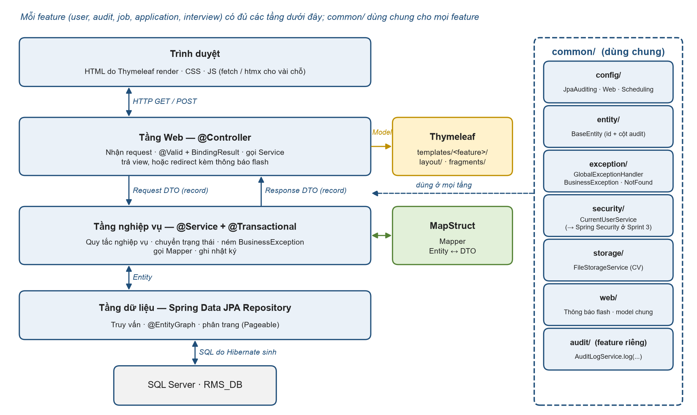
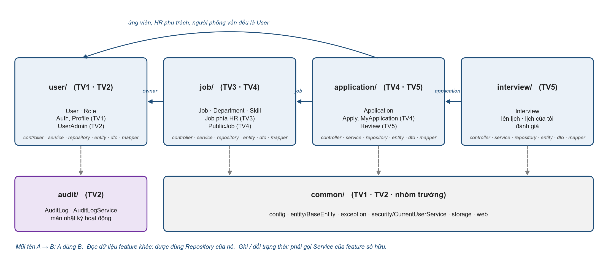

# Kiến trúc & quy ước code — RMS

Cách tổ chức và viết code của dự án. Thiết kế dữ liệu (bảng, cột): [database.md](database.md).

## 1. Tổng quan



- Ứng dụng web render phía server bằng Thymeleaf. JavaScript chỉ dùng cho vài chỗ cần mượt (mục 5).
- Chia package **theo feature**. Mỗi feature có đủ `controller → service → repository → entity`, kèm `dto` và `mapper`.
- `common/` chứa những thứ dùng chung, không chứa nghiệp vụ.

## 2. Cấu trúc package



```
src/main/java/com/group3/rms/
├── RmsApplication.java
├── common/                      DÙNG CHUNG — không chứa nghiệp vụ
│   ├── config/AppConfig         MỌI bean / @Enable... dùng chung đặt ở đây, không tạo file config lẻ:
│   │                            JPA auditing, PasswordEncoder (BCrypt), sau thêm @EnableScheduling
│   ├── entity/BaseEntity        id + 4 cột audit tự điền
│   ├── exception/               BusinessException, NotFoundException, ForbiddenException,
│   │                            GlobalExceptionHandler, ApiExceptionHandler
│   ├── security/                CurrentUser, CurrentUserService, DevCurrentUserService ("đóng vai")
│   │                            → khi bật Spring Security thêm SecurityConfig
│   ├── storage/                 FileStorageService (lưu / đọc file CV)
│   └── web/                     GlobalModelAttributes (đưa currentUser vào mọi trang),
│                                HomeController ("/" → trang chủ theo vai trò)
├── user/          AuthController (/login, /register, /logout), ProfileController (/profile),
│                  AdminUserController (/admin/users)
├── audit/         ActivityLogController (/admin/activity-logs), AuditLogService
├── job/           HrJobController (/hr/jobs, kể cả /hr/jobs/{id}/applications), PublicJobController (/jobs),
│                  JobAutoCloseScheduler (tự đóng tin hết hạn)
├── application/   ApplyController (/jobs/{id}/apply), MyApplicationController (/my/applications),
│                  ApplicationReviewController (/applications/{id})
└── interview/     InterviewController (/applications/{id}/interviews/new, /interviews/my,
                   /interviews/{id}/evaluation)
```

Bên trong một feature, ví dụ `job/`:

```
job/
├── controller/   HrJobController, PublicJobController
├── service/      JobService, JobServiceImpl, PublicJobService, PublicJobServiceImpl, JobAutoCloseScheduler
├── repository/   JobRepository, DepartmentRepository, SkillRepository
├── entity/       Job, JobStatus, Department, Skill
├── dto/          JobCreateRequest, JobUpdateRequest, JobResponse, JobSummaryResponse
└── mapper/       JobMapper
```

Giao diện và cấu hình:

```
src/main/resources/
├── application.properties              cấu hình chung (commit)
├── application-local.properties        mật khẩu DB của từng máy (KHÔNG commit)
├── templates/
│   ├── layout/
│   │   ├── public.html      Guest + Candidate: thanh menu ngang
│   │   ├── staff.html       Admin / HR / Interviewer: menu bên trái theo vai trò
│   │   └── auth.html        đăng nhập / đăng ký: không menu
│   ├── fragments/           flash.html (thông báo), pagination.html, confirm-dialog.html,
│   │                        status-badge.html (nhãn màu trạng thái tin / hồ sơ / phỏng vấn)
│   ├── error/               403.html, 404.html, 500.html
│   ├── auth/                login (SCR-01), register (SCR-02)
│   ├── profile/             view (SCR-03), password (SCR-04)
│   ├── admin/               user-list (SCR-05), user-form (SCR-06), user-detail (SCR-07), activity-log (SCR-08)
│   ├── job/                 list (SCR-09), form (SCR-10), detail (SCR-11), applications (SCR-12)   ← phía HR
│   ├── career/              list (SCR-13), detail (SCR-14), apply (SCR-15)                       ← công khai
│   ├── application/         my-list (SCR-16), detail (SCR-17)
│   └── interview/           form (SCR-18), my-schedule (SCR-19), evaluation (SCR-20)
└── static/
    ├── css/app.css          1 file CSS chung (bổ sung cho Bootstrap)
    ├── js/app.js            hàm dùng chung (fetch kèm CSRF, hộp xác nhận); trang cần riêng thì js/<trang>.js
    └── images/              logo

uploads/cv/                                  nơi lưu CV, ngoài code, đã gitignore
src/test/java/com/group3/rms/<feature>/      test đặt theo đúng package
```

- Giao diện dùng **Bootstrap 5 qua CDN**, nhúng một lần trong 3 file layout; trang con không tự nhúng thêm thư viện.
- Mỗi trang khai báo layout bằng `layout:decorate="~{layout/staff}"` (hoặc `public` / `auth`) và chỉ viết phần nội dung.

**Quy tắc phụ thuộc**

1. Controller chỉ gọi Service. Không gọi Repository, không nhận/trả Entity.
2. Đọc dữ liệu của feature khác: được dùng Repository của feature đó.
3. Ghi hoặc đổi trạng thái dữ liệu của feature khác: **phải gọi Service** của feature sở hữu (để không ai bỏ qua quy tắc nghiệp vụ).
4. Chỉ sửa file trong phạm vi chức năng hoặc việc chung đã được phân công. TV2 phụ trách `BaseEntity`, JPA Auditing trong `AppConfig` và exception handling; phối hợp TV1 khi nối `AuditorAware` với `CurrentUserService`. Các phần dùng chung khác (mục 3) và entity cần đổi thì báo nhóm / chủ file trước.

## 3. Các file dùng chung

| File | Vai trò |
| :--- | :--- |
| `common/entity/BaseEntity` | `id` + 4 cột audit tự điền |
| `common/config/AppConfig` | Mọi bean dùng chung: đã có `@EnableJpaAuditing(auditorAwareRef = "auditorAware")` + `AuditorAware<String>` hiện trả `system`; khi có `CurrentUserService` thì lấy username, chưa đăng nhập dùng `system`. Có `PasswordEncoder` (BCrypt), sau thêm `@EnableScheduling`; không tạo `JpaAuditingConfig` riêng |
| `common/exception/*` | Ngoại lệ dùng chung và xử lý lỗi tập trung (mục 4) |
| `audit/AuditLogService` | `log(action, targetType, targetId, detail)`; về sau có thể ghi tự động bằng AOP `@Audited` |
| `common/security/CurrentUserService` | Người dùng đang đăng nhập |
| `common/web/GlobalModelAttributes` | `@ControllerAdvice` thêm `currentUser` vào mọi view (menu, tên trên header) |
| `templates/layout/*`, `fragments/*` | Layout, thông báo flash, phân trang, hộp xác nhận |
| `common/storage/FileStorageService` | Lưu / đọc file CV ngoài thư mục web |

```java
@MappedSuperclass
@EntityListeners(AuditingEntityListener.class)
@Getter
public abstract class BaseEntity {
    @Id
    @GeneratedValue(strategy = GenerationType.IDENTITY)
    private Long id;

    @CreatedDate
    @Column(name = "created_at", nullable = false, updatable = false)
    private LocalDateTime createdAt;

    @LastModifiedDate
    @Column(name = "updated_at")
    private LocalDateTime updatedAt;

    @CreatedBy
    @Column(name = "created_by", length = 50, updatable = false)
    private String createdBy;

    @LastModifiedBy
    @Column(name = "updated_by", length = 50)
    private String updatedBy;
}
```

`users`, `jobs`, `applications`, `interviews` kế thừa `BaseEntity` (`id` + 4 cột audit). `roles`, `departments`, `skills`, `audit_logs` có khóa chính `id` riêng. `user_roles` có khóa chính ghép `(user_id, role_id)`; `job_skills` có khóa chính ghép `(job_id, skill_id)`. Hai bảng nối không có cột `id` độc lập và vẫn ánh xạ qua `@ManyToMany`, không tạo entity mới. JPA Auditing qua `BaseEntity` chỉ áp dụng cho bốn bảng nghiệp vụ nêu trên.

```java
public record CurrentUser(Long id, String username, String fullName, RoleCode role) {}

public interface CurrentUserService {
    Optional<CurrentUser> get();   // chưa đăng nhập → Optional.empty()
    CurrentUser require();         // chưa đăng nhập → ném ForbiddenException
}
```

- **Trước khi có Spring Security:** bản dev lưu người dùng được chọn trong session. Thanh điều hướng có ô "Đóng vai: hr1 / interviewer1 / candidate1…", chỉ bật ở profile `local`.
- **Khi bật Spring Security:** thay bằng bản đọc từ `SecurityContextHolder`. Code đang gọi `CurrentUserService` giữ nguyên.

## 4. Validate và xử lý lỗi: dùng cả hai, mỗi cái một việc

| Tình huống | Cách xử lý | Ví dụ |
| :--- | :--- | :--- |
| Dữ liệu form sai định dạng, thiếu | `@Valid` + `BindingResult` trong controller → trả lại form, lỗi dưới từng ô | Tiêu đề trống, lương âm |
| Quy tắc nghiệp vụ gắn với một ô của form | Service ném `BusinessException(field, message)` → controller bắt, gắn vào `BindingResult` → trả lại form | Tên đăng nhập đã tồn tại |
| Quy tắc nghiệp vụ khi bấm nút hành động | Service ném `BusinessException` → `GlobalExceptionHandler`: thông báo flash + quay về trang trước | Tuyển khi còn vòng chưa đánh giá |
| Không tìm thấy | `NotFoundException` → trang 404 | `/hr/jobs/999` |
| Không có quyền | `ForbiddenException` → trang 403 | Interviewer mở hồ sơ không được giao |
| Lỗi ngoài dự kiến | `log.error(...)` + trang 500, không lộ stack trace | Mất kết nối CSDL |
| Gọi AJAX (`/api/**`) | `ApiExceptionHandler` trả JSON `ProblemDetail` | Kiểm tra username trùng |

```java
public class BusinessException extends RuntimeException {
    private final String field;   // null = lỗi chung của form

    public BusinessException(String message) { this(null, message); }

    public BusinessException(String field, String message) {
        super(message);
        this.field = field;
    }

    public void applyTo(BindingResult result) {
        if (field != null) result.rejectValue(field, "business", getMessage());
        else result.reject("business", getMessage());
    }
}
```

**Màn hình form** (tạo / sửa):

```java
@PostMapping("/hr/jobs")
public String create(@Valid @ModelAttribute("form") JobCreateRequest form, BindingResult result,
                     Model model, RedirectAttributes ra) {
    if (!result.hasErrors()) {
        try {
            Long id = jobService.create(form);
            ra.addFlashAttribute("success", "Đã lưu tin ở trạng thái Nháp.");
            return "redirect:/hr/jobs/" + id;
        } catch (BusinessException e) {
            e.applyTo(result);
        }
    }
    model.addAttribute("departments", departmentService.findAll());
    return "job/form";
}
```

**Nút hành động** (không cần try/catch):

```java
@PostMapping("/applications/{id}/hire")
public String hire(@PathVariable Long id, RedirectAttributes ra) {
    applicationReviewService.hire(id);   // vi phạm quy tắc → BusinessException
    ra.addFlashAttribute("success", "Đã chuyển hồ sơ sang Đã tuyển.");
    return "redirect:/applications/" + id;
}
```

**Xử lý tập trung:**

```java
@ControllerAdvice
@Slf4j
public class GlobalExceptionHandler {

    @ExceptionHandler(BusinessException.class)
    public String business(BusinessException e, HttpServletRequest request, RedirectAttributes ra) {
        ra.addFlashAttribute("error", e.getMessage());
        return "redirect:" + sameSiteReferer(request);   // chỉ quay về trang cùng ứng dụng, mặc định "/"
    }

    @ExceptionHandler({NotFoundException.class, NoResourceFoundException.class})
    @ResponseStatus(HttpStatus.NOT_FOUND)
    public String notFound() { return "error/404"; }

    @ExceptionHandler(ForbiddenException.class)
    @ResponseStatus(HttpStatus.FORBIDDEN)
    public String forbidden() { return "error/403"; }

    @ExceptionHandler(Exception.class)
    @ResponseStatus(HttpStatus.INTERNAL_SERVER_ERROR)
    public String unexpected(Exception e) {
        log.error("Lỗi không mong đợi", e);
        return "error/500";
    }
}
```

- Phân quyền, trạng thái tài khoản, quyền sở hữu và quy tắc nghiệp vụ **luôn kiểm tra tại Service bằng dữ liệu hiện tại**, kể cả khi giao diện đã ẩn nút hoặc yêu cầu đến từ phiên cũ. Áp dụng cho cả người thực hiện và tài khoản / dữ liệu đích theo UC. Ẩn nút chỉ để dễ dùng, không phải để bảo mật.
- Khi bật Spring Security: thêm `AccessDeniedException` của Spring Security vào nhóm 403, để handler `Exception` không biến nó thành 500.
- `ApiExceptionHandler` đặt `@Order(Ordered.HIGHEST_PRECEDENCE)` và chỉ áp dụng cho `@RestController`.

## 5. AJAX: server render là chính, AJAX chỉ ở vài chỗ

- Mặc định: form submit thường, kiểu **POST → redirect → GET** để F5 không gửi lại form.
- AJAX chỉ dùng khi thật sự cải thiện trải nghiệm, khoảng 2–3 chỗ. Ví dụ: kiểm tra tên đăng nhập trùng khi đang gõ (SCR-02), đổi tab lọc không tải lại trang.
- Endpoint AJAX đặt dưới `/api/**`, dùng `@RestController` trả `record`. Phía trình duyệt dùng `fetch()`, không cần jQuery. Muốn trả về mẩu HTML thì dùng htmx với fragment Thymeleaf.
- Khi bật Spring Security: gửi kèm CSRF token trong header (đọc từ thẻ `<meta>` trong layout).
- `@Async` của Spring (chạy việc ngầm) không dùng trong dự án này.

## 6. DTO, Mapper, Entity, Service

| Thành phần | Quy ước |
| :--- | :--- |
| Request DTO | `record` + Bean Validation: `XxxCreateRequest`, `XxxUpdateRequest`. Kiểm tra chéo nhiều ô dùng `@AssertTrue` |
| Response DTO | `record`: `XxxResponse`, `XxxSummaryResponse` (cho danh sách) |
| Entity | `class` + Lombok `@Getter @Setter @NoArgsConstructor`. Không dùng `@Data`, không dùng `record` |
| Enum | `@Enumerated(EnumType.STRING)`, tên viết hoa: `JobStatus.ACTIVE` |
| Mapper | MapStruct, đã cấu hình `componentModel = spring` trong `pom.xml`. Bỏ qua `id` và cột audit khi map vào entity |
| Service | Interface + `Impl` (theo bài giảng): `JobService`, `JobServiceImpl`. `@Transactional` đặt ở Impl |
| Inject | `private final` + `@RequiredArgsConstructor`. Không dùng `@Autowired` trên field |
| Log | `@Slf4j` + `log.info / warn / error`. Không dùng `System.out.println` |

- Template chỉ nhận DTO, **không bao giờ nhận Entity**.
- Form Thymeleaf dùng Request `record`. Làm thử ngay ở form đầu tiên cả ba trường hợp: tạo mới, sửa, hiển thị lại khi lỗi. Nếu `th:field` gặp lỗi binding, dùng class Lombok cho riêng loại form đó.

## 7. Truy vấn và transaction

- Hàm chỉ đọc: `@Transactional(readOnly = true)`.
- `spring.jpa.open-in-view=false`, nên dữ liệu liên quan phải được tải sẵn trong service. Dùng `@EntityGraph` hoặc `JOIN FETCH` ở repository (ví dụ danh sách tin kèm phòng ban, kỹ năng) để tránh N+1.
- Danh sách có phân trang: repository nhận `Pageable`, service trả `Page<XxxSummaryResponse>`. Bộ lọc để trên URL.
- Lọc nhiều điều kiện tùy chọn (SCR-05, SCR-08, SCR-13): dùng `Specification` hoặc truy vấn JPQL có điều kiện `IS NULL`.

## 8. Đặt tên

| Thứ | Quy ước | Ví dụ |
| :--- | :--- | :--- |
| Bảng | `snake_case`, số nhiều | `users`, `job_skills` |
| Cột | `snake_case` | `created_at`, `owner_id` |
| URL | danh từ số nhiều, `kebab-case`; đổi dữ liệu dùng POST | `GET /hr/jobs`, `POST /hr/jobs/{id}/publish` |
| Template | `templates/<feature>/<man-hinh>.html` | `job/list.html`, `job/form.html` |

## 9. Dữ liệu và cấu hình

- Entity là nguồn sự thật của schema. Ở môi trường dev, Hibernate tự tạo/cập nhật bảng: `spring.jpa.hibernate.ddl-auto=update`. Không có `schema.sql`, không có file migration viết tay.
- Dữ liệu mẫu nằm ở `database/seed.sql`, chạy tay. Cách reset DB và tài khoản mẫu: [database.md](database.md).
- Sửa entity thì sửa luôn `seed.sql` và [database.md](database.md) trong cùng PR, tiêu đề PR thêm `[DB]`.
- Mật khẩu CSDL chỉ để trong `application-local.properties` (đã gitignore).
- Bật cột tiếng Việt cho SQL Server: `spring.jpa.properties.hibernate.use_nationalized_character_data=true`.

## 10. Bảo mật

| Giai đoạn | Việc |
| :--- | :--- |
| Từ đầu | Mật khẩu băm BCrypt (chỉ thêm `spring-security-crypto`, chưa thêm `spring-boot-starter-security`); URL theo tiền tố vai trò ngay từ đầu (`/admin/**`, `/hr/**`, `/interviews/**`, `/my/**`; công khai `/`, `/jobs/**`); layout có sẵn thẻ `<meta>` CSRF; mọi thao tác đổi dữ liệu dùng POST; in dữ liệu bằng `th:text`; kiểm tra quyền sở hữu ở service (HR phụ trách, người phỏng vấn được giao, Candidate chủ hồ sơ); file CV lưu ngoài thư mục web, kiểm tra quyền trước khi tải |
| Giai đoạn cuối | Spring Security: form login, phân quyền URL theo vai trò (`/admin/**`, `/hr/**`, `/interviews/**`, `/my/**`), CSRF, trang 403; thay `CurrentUserService` |

Các ràng buộc quản trị trong đặc tả tại `docs/requirements/` phải được kiểm tra ở Service:

- Toàn hệ thống có **duy nhất một tài khoản `ADMIN` được khởi tạo sẵn**, chính là Super Admin; không tạo role `SUPER_ADMIN`. Không tạo thêm ADMIN, nâng tài khoản khác lên ADMIN, khóa ADMIN hoặc đổi ADMIN sang vai trò khác. UC-07/08/09 không được thay đổi tài khoản ADMIN.
- Chỉ Super Admin thực hiện UC-06–10. UC-07 chỉ tạo HR / INTERVIEWER ở trạng thái ACTIVE, giữ validation theo đặc tả và chỉ ghi `CREATE_ACCOUNT` khi thành công.
- UC-08 cho khóa / mở khóa HR, INTERVIEWER, CANDIDATE; HR / INTERVIEWER còn công việc vẫn được khóa sau cảnh báo gián đoạn và xác nhận. Không tự chuyển giao, xóa hoặc thay đổi tin, hồ sơ, lịch phỏng vấn, lịch sử. INACTIVE không đăng nhập hoặc tiếp tục thao tác bằng phiên cũ; từ chối thao tác trùng trạng thái. Chỉ ghi `LOCK_ACCOUNT` / `UNLOCK_ACCOUNT` khi thành công.
- UC-09 chỉ cho `HR ↔ INTERVIEWER`; ADMIN / CANDIDATE không tham gia theo bất kỳ chiều nào. Chặn HR → INTERVIEWER nếu còn tin phụ trách DRAFT / ACTIVE chưa xóa, hoặc tin CLOSED chưa xóa có hồ sơ APPLIED / INTERVIEW. INTERVIEWER → HR giữ nguyên lịch được giao và đánh giá, không tự hủy; quyền xử lý theo quy định hiện hành. Mỗi tài khoản đúng một role qua `user_roles`; chọn lại role hiện tại không cập nhật / ghi log. Chỉ ghi `CHANGE_ROLE` khi đổi thành công.
- UC-10 chỉ Super Admin xem audit log, không sửa / xóa; nghiệp vụ UC-06 giữ nguyên.
