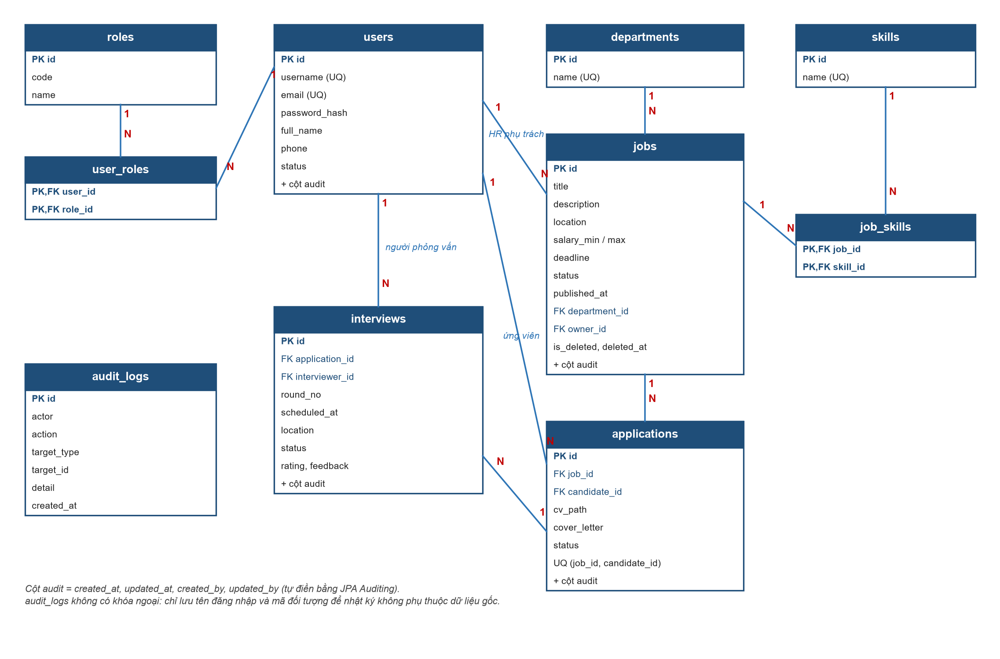

# Thiết kế dữ liệu — RMS

Đặc tả 10 bảng, cách dùng database và tài khoản mẫu. Sửa entity thì sửa file này trong cùng PR.

- CSDL: **Microsoft SQL Server**. **Không có file tạo bảng, không có migration**: bảng do Hibernate tự sinh từ entity Java khi chạy app (`ddl-auto=update`).
- Mọi cột chữ thực tế là `NVARCHAR` (kể cả cột ghi `VARCHAR` bên dưới) do bật `use_nationalized_character_data` để lưu tiếng Việt.
- Cột enum (`status`, `code`, `action`…) được Hibernate gắn ràng buộc CHECK theo danh sách giá trị enum.

## 1. ERD



- Candidate, HR, Interviewer, Admin đều nằm trong bảng `users`, phân biệt bằng vai trò.
- Hai quan hệ nhiều – nhiều: `users` – `roles` (`user_roles`) và `jobs` – `skills` (`job_skills`).
- Đánh giá phỏng vấn nằm trong bảng `interviews` (`rating`, `feedback`), không tách bảng.
- Phòng ban, kỹ năng, vai trò được nạp sẵn bằng `database/seed.sql`.
- Bảng `users`, `jobs`, `applications`, `interviews` kế thừa `BaseEntity` (`id` + 4 cột audit: `created_at`, `updated_at`, `created_by`, `updated_by`, do JPA Auditing tự điền). Bảng danh mục, bảng nối và `audit_logs` tự khai báo `id`.

## 2. Chi tiết bảng

Cột audit (`created_at DATETIME2 NOT NULL`, `updated_at DATETIME2`, `created_by NVARCHAR(50)`, `updated_by NVARCHAR(50)`) ghi gọn là **[audit]**.

### users — Mọi tài khoản: Admin, HR, Interviewer, Candidate

| Cột | Kiểu | Ràng buộc | Ghi chú |
| :--- | :--- | :--- | :--- |
| id | BIGINT | PK, IDENTITY | |
| username | NVARCHAR(50) | NOT NULL, UNIQUE | |
| email | NVARCHAR(255) | NOT NULL, UNIQUE | |
| password_hash | VARCHAR(255) | NOT NULL | BCrypt |
| full_name | NVARCHAR(100) | NOT NULL | |
| phone | VARCHAR(20) | | |
| status | VARCHAR(20) | NOT NULL | `ACTIVE` / `INACTIVE` |
| [audit] | | | |

### roles — Danh mục vai trò (nạp sẵn)

| Cột | Kiểu | Ràng buộc | Ghi chú |
| :--- | :--- | :--- | :--- |
| id | BIGINT | PK, IDENTITY | |
| code | VARCHAR(30) | NOT NULL, UNIQUE | `ADMIN` / `HR` / `INTERVIEWER` / `CANDIDATE` |
| name | NVARCHAR(50) | NOT NULL | Tên hiển thị |

### user_roles — Bảng nối users – roles (`@ManyToMany`)

| Cột | Kiểu | Ràng buộc |
| :--- | :--- | :--- |
| user_id | BIGINT | PK, FK → users |
| role_id | BIGINT | PK, FK → roles |

### departments — Phòng ban (nạp sẵn)

| Cột | Kiểu | Ràng buộc |
| :--- | :--- | :--- |
| id | BIGINT | PK, IDENTITY |
| name | NVARCHAR(100) | NOT NULL, UNIQUE |

### skills — Kỹ năng (nạp sẵn)

| Cột | Kiểu | Ràng buộc |
| :--- | :--- | :--- |
| id | BIGINT | PK, IDENTITY |
| name | NVARCHAR(100) | NOT NULL, UNIQUE |

### jobs — Tin tuyển dụng

| Cột | Kiểu | Ràng buộc | Ghi chú |
| :--- | :--- | :--- | :--- |
| id | BIGINT | PK, IDENTITY | |
| title | NVARCHAR(200) | NOT NULL | |
| description | NVARCHAR(MAX) | NOT NULL | |
| location | NVARCHAR(200) | | |
| salary_min | DECIMAL(15,2) | | ≥ 0 |
| salary_max | DECIMAL(15,2) | | ≥ salary_min |
| deadline | DATE | NOT NULL | Hạn nộp |
| status | VARCHAR(20) | NOT NULL | `DRAFT` / `ACTIVE` / `CLOSED` |
| published_at | DATETIME2 | | |
| department_id | BIGINT | NOT NULL, FK → departments | |
| owner_id | BIGINT | NOT NULL, FK → users | HR phụ trách |
| is_deleted | BIT | NOT NULL, mặc định 0 | Xóa mềm |
| deleted_at | DATETIME2 | | |
| [audit] | | | |

### job_skills — Bảng nối jobs – skills (`@ManyToMany`)

| Cột | Kiểu | Ràng buộc |
| :--- | :--- | :--- |
| job_id | BIGINT | PK, FK → jobs |
| skill_id | BIGINT | PK, FK → skills |

### applications — Hồ sơ ứng tuyển

| Cột | Kiểu | Ràng buộc | Ghi chú |
| :--- | :--- | :--- | :--- |
| id | BIGINT | PK, IDENTITY | |
| job_id | BIGINT | NOT NULL, FK → jobs | |
| candidate_id | BIGINT | NOT NULL, FK → users | |
| cv_path | VARCHAR(500) | NOT NULL | Đường dẫn file đã đặt lại tên |
| cv_original_name | NVARCHAR(255) | NOT NULL | Tên file gốc khi tải về |
| cover_letter | NVARCHAR(2000) | | |
| status | VARCHAR(20) | NOT NULL | `APPLIED` / `INTERVIEW` / `HIRED` / `REJECTED` / `WITHDRAWN` |
| status_changed_at | DATETIME2 | | |
| [audit] | | | |

Ràng buộc: `UNIQUE (job_id, candidate_id)` — mỗi người nộp 1 lần / tin.

### interviews — Các vòng phỏng vấn, kèm đánh giá

| Cột | Kiểu | Ràng buộc | Ghi chú |
| :--- | :--- | :--- | :--- |
| id | BIGINT | PK, IDENTITY | |
| application_id | BIGINT | NOT NULL, FK → applications | |
| interviewer_id | BIGINT | NOT NULL, FK → users | HR hoặc Interviewer |
| round_no | INT | NOT NULL | 1, 2, 3… |
| scheduled_at | DATETIME2 | NOT NULL | |
| location | NVARCHAR(500) | | Phòng họp hoặc link |
| status | VARCHAR(20) | NOT NULL | `SCHEDULED` / `EVALUATED` |
| rating | TINYINT | | 1–5, có khi đã đánh giá |
| feedback | NVARCHAR(MAX) | | |
| evaluated_at | DATETIME2 | | |
| [audit] | | | |

### audit_logs — Nhật ký hoạt động (chỉ thêm, không sửa)

| Cột | Kiểu | Ràng buộc | Ghi chú |
| :--- | :--- | :--- | :--- |
| id | BIGINT | PK, IDENTITY | |
| actor | NVARCHAR(50) | NOT NULL | Tên đăng nhập hoặc `system` |
| action | VARCHAR(50) | NOT NULL | Xem mục 3 |
| target_type | VARCHAR(30) | | `USER` / `JOB` / `APPLICATION` / `INTERVIEW` |
| target_id | BIGINT | | |
| detail | NVARCHAR(500) | | Mô tả ngắn |
| created_at | DATETIME2 | NOT NULL | |

## 3. Hành động được ghi nhật ký (`AuditAction`)

| Hành động | Ý nghĩa | Use Case |
| :--- | :--- | :--- |
| `REGISTER` | Candidate tự đăng ký | UC-02 |
| `CREATE_ACCOUNT` | Admin tạo tài khoản nhân viên | UC-07 |
| `LOCK_ACCOUNT` / `UNLOCK_ACCOUNT` | Admin khóa / mở khóa tài khoản | UC-08 |
| `CHANGE_ROLE` | Admin đổi vai trò | UC-09 |
| `CREATE_JOB` / `UPDATE_JOB` | HR tạo / sửa tin | UC-12, UC-13 |
| `PUBLISH_JOB` / `CLOSE_JOB` / `DELETE_JOB` | Đổi trạng thái tin (kể cả tự đóng) | UC-14 |
| `APPLY` / `WITHDRAW` | Candidate nộp / rút hồ sơ | UC-18, UC-20 |
| `CHANGE_APPLICATION_STATUS` | HR duyệt / loại / tuyển | UC-22 |
| `SCHEDULE_INTERVIEW` | HR lên lịch phỏng vấn | UC-23 |
| `SUBMIT_EVALUATION` | Người phỏng vấn gửi đánh giá | UC-25 |

## 4. Dữ liệu mẫu tối thiểu (`database/seed.sql`)

Đủ để mỗi thành viên làm việc độc lập, không chờ màn hình của người khác:

- 4 vai trò; 1 Admin, 2 HR, 2 Interviewer, 7 Candidate (họ tên, email, số điện thoại khớp CV mẫu) (mật khẩu chung cho môi trường dev, ghi ở đầu file `seed.sql`).
- 4 phòng ban, 12 kỹ năng.
- 6 tin: 1 `DRAFT`, 4 `ACTIVE` (của cả 2 HR), 1 `CLOSED`.
- 8 hồ sơ phủ đủ 5 trạng thái; mỗi hồ sơ gắn một CV PDF thật trong `src/main/resources/static/sample/cv` (đường dẫn `seed/<tên file>`, `LocalFileStorageService` tự đọc từ đó nên tải CV được ngay).
- Lịch phỏng vấn: vài buổi đã qua giờ chưa đánh giá (để demo UC-25), vài buổi sắp tới, vài buổi đã đánh giá.
- **Không** đặt `CHECK` kiểu "ngày phải ở tương lai" trong DB — quy tắc đó kiểm tra ở service, nếu không dữ liệu mẫu quá khứ sẽ không nạp được.

**Tài khoản mẫu** — mật khẩu chung `Test@123`:

| Tài khoản | Vai trò |
| :--- | :--- |
| `admin` | ADMIN |
| `hr1`, `hr2` | HR |
| `interviewer1`, `interviewer2` | INTERVIEWER |
| `candidate1` … `candidate7` | CANDIDATE |

Đầu file `seed.sql` có mô tả kịch bản demo sẵn (buổi phỏng vấn nào đang chờ đánh giá, buổi nào sắp tới…).

## 5. Cách dùng

| Việc | Làm thế nào |
| :--- | :--- |
| Lần đầu | Tạo DB rỗng `RMS_DB` → chạy app (bảng tự sinh) → chạy `database/seed.sql` |
| Cần thêm / sửa cột | Sửa **entity Java**, không viết SQL. Sửa luôn `seed.sql` và file này trong cùng PR, tiêu đề PR thêm `[DB]` |
| Kéo về một PR `[DB]` | Reset DB. App chỉ tự **thêm** cột, không xóa cột cũ, không cập nhật danh sách giá trị enum |
| Muốn dữ liệu sạch lại | Reset DB |

**Reset DB:**

```sql
USE master;
ALTER DATABASE RMS_DB SET SINGLE_USER WITH ROLLBACK IMMEDIATE;
DROP DATABASE RMS_DB;
CREATE DATABASE RMS_DB;
```

Rồi chạy app một lần để sinh bảng, dừng app, chạy `database/seed.sql`:
- SSMS / Azure Data Studio: mở file, chọn database `RMS_DB`, Execute.
- Dòng lệnh: `sqlcmd -S localhost -E -C -d RMS_DB -f 65001 -i database/seed.sql` (`-f 65001` để không lỗi font tiếng Việt; dùng tài khoản `sa` thì thay `-E` bằng `-U sa -P <mật khẩu>`).
